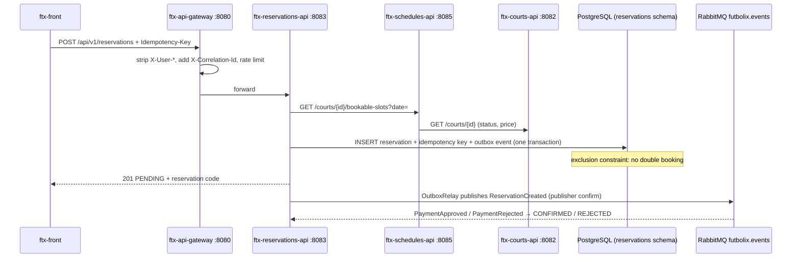

# ftx-workflow

> The Futbolix reservation flow end to end: the platform composition, the message broker and the
> failure-injection demo of the release

Part of **Futbolix**, the distributed system for reserving the four football courts of a single
sports facility. Governance and documentation live in
[`ftx-docs`](https://github.com/code-corhuila/ftx-docs).

## What this repository is

The original README said "business process orchestration (saga)". **ADR-010** chose
**choreography** instead: each service reacts to the others' events on `futbolix.events`, so
there is no orchestrator to build. ADR-009 left the role of this repository open; it now holds
what belongs to the *flow* and to no single service:

| Holds | Why here |
|---|---|
| `compose.yml`: every service of the flow on the `platform` network, through each repository's own `deploy/compose.yml` | One command starts the whole system; each service keeps owning its container definition |
| The RabbitMQ broker (`futbolix.events`) | Shared by every service; no domain owns it |
| `scripts/start-platform.ps1` | Database → migrations → broker and services → gateway, in order |
| `scripts/demo-falla.ps1` | The end-to-end checks and the **injected failures** of the release demo, with PASS/FAIL and a saved transcript |

It holds **no database** (the single instance is `ftx-infra-postgres`, Annex J) and **no domain
logic**.

## The flow



## Start everything

Clone every repository **in the same folder** (`ftx-infra-postgres`, the four `-db`, the four
`-api`, `ftx-api-gateway` and this one), check out the branch to run, then on Windows:

```
start-platform.bat        (or: powershell -File scripts/start-platform.ps1)
```

It needs `../ftx-infra-postgres/env/dev.env` (see that README). Besides the variables the other
services already use, it must contain `RESERVATIONS_APP_PASSWORD=<random>`; and
`ftx-infra-postgres/postgres/init/01-instance.sh` should create `reservations_app` like the other
`*_app` users. Until it does, the script creates the user itself and warns. The broker password is
generated at random into `env/dev.env` the first time (never versioned, M2).

| URL | What |
|---|---|
| http://localhost:8080 | API (gateway). `ftx-front` uses `VITE_API_BASE_URL=http://localhost:8080` |
| http://localhost:8080/health | State of every service |
| http://localhost:15672 | RabbitMQ management (user and password in `env/dev.env`) |

`stop-platform.bat` stops broker, services and gateway, never the volumes.

## The release demo: injected failures

```
demo-falla.bat
```

| Part | What is injected | What must happen |
|---|---|---|
| A | nothing | availability → 201 `PENDING` with the server-side amount → same `Idempotency-Key` returns the same reservation → look-up by code → the event reaches RabbitMQ |
| B | `docker compose stop rabbitmq` | reservations are still created; the event **waits in the outbox**; the health reports the broker; when RabbitMQ is back the relay **publishes it** (ADR-006) |
| C | `docker compose stop ftx-schedules-api` | availability fails **fast** with 503; look-up and cancellation by code **keep working**; the gateway says `degraded`; then it recovers |
| D | 5 simultaneous requests for one slot | exactly **one 201** and four **409** `RESERVATION_SLOT_UNAVAILABLE` (database exclusion constraint) |
| E | an attacker | no token or spoofed `X-User-Role` → 401; a client-sent `amount` → 400 |

The run prints PASS/FAIL per check and is saved to `demo-output-<date>.txt`, the evidence for the
release. Run it once per minute at most: the gateway limits reservation creation to 10 per minute
per client.

## Known limits

- **No payment service yet** (ADR-009 open): reservations stay `PENDING`. Nothing fakes a payment
  approval, so no reservation is ever `CONFIRMED` without evidence from the provider (M8).
- One gateway instance: rate-limit counters are in memory.

## Branching

`develop`, `qa` and `main` accept no direct commits. `hu-<id>-dev → develop`, then
`git cherry-pick -x` into `qa`, then into a release branch `→ main` with the instructor's approval
and the tag `v3.0.0`.
